# ProjectTruth Monitor architecture

## Summary

ProjectTruth Monitor is a Python 3.13 FastAPI modular monolith. One deployable application owns the authenticated HTML dashboard, versioned JSON API, deterministic monitoring pipeline, private document storage, optional local scheduled work, and report generation. SQLite is the configured local and Docker database. `DATABASE_URL` and the included driver provide a PostgreSQL boundary, but production PostgreSQL behavior has not been qualified by this MVP.

The system is designed around one rule: a displayed factual change must be traceable to old and new immutable snapshots and permitted evidence. Missing, blocked, stale, or conflicting information remains visibly uncertain.

```mermaid
flowchart LR
    UI["Jinja2 dashboard + local HTMX"] --> AUTH["Session auth, CSRF, tenant and role checks"]
    API["FastAPI /api/v1"] --> AUTH
    AUTH --> APP["Application services"]
    APP --> POLICY["Source access policy gate"]
    POLICY --> JOB["Monitoring job and idempotency"]
    JOB --> COLLECT["Fixture, HRERA, developer, or upload collector"]
    COLLECT --> PARSE["Versioned parser"]
    PARSE --> FACTS["Raw source facts"]
    FACTS --> SNAP["Immutable canonical snapshot"]
    SNAP --> DIFF["Deterministic diff and signal rules"]
    DIFF --> EVIDENCE["Evidence cards and confidence dimensions"]
    EVIDENCE --> REVIEW["Human review, conflicts, audit"]
    REVIEW --> OUTPUT["Timeline, digest, report, CSV, JSON, PDF"]
    APP --> DB[("SQLAlchemy database")]
    COLLECT --> PRIVATE[("Private uploads and reports")]
```

## Modules

| Area | Responsibility |
| --- | --- |
| `app/core` | Configuration, session security, permissions, CSRF, request IDs, safe errors, logging, upload and rate-limit helpers. |
| `app/api/v1` | HTTP transport, Pydantic validation, authenticated actor resolution, tenant constraints, role gates, safe response models, and audit calls. |
| `app/models` | Normalized SQLAlchemy persistence for identity, monitoring, documents, intelligence, governance, audit, and deletion. |
| `app/services` | Identity, policy, normalization, immutable snapshot, diff, signal, confidence, conflict, evidence, impact, report, and deletion behavior. |
| `app/collectors` | Policy-aware source adapters. Frozen fixtures are the reliable demo path; network access is optional. |
| `app/parsers` | Versioned HTML and PDF parsing plus disabled-by-default OCR and LLM provider interfaces. |
| `app/jobs` | Optional single-process APScheduler lifecycle plus reusable retry, circuit-breaker, and monitoring-task primitives. |
| `app/templates` | Jinja2 templates and routes for the 21 required dashboard view categories. Templates accept mappings or objects and display source and freshness metadata. |
| `app/static` | Responsive local CSS, official vendored HTMX 2.0.10, progressive form helpers, SVG mark, and example CSV. No build pipeline or CDN is required. |
| `app/fixtures/html` | Docker runtime copy of the frozen synthetic HTML fixtures. Local development falls back to `tests/fixtures/html`. |
| `app/policies` | Versioned source-policy defaults. Live HRERA is disabled pending an explicit review. |
| `alembic` | Database schema creation and upgrades. Application startup must not call `Base.metadata.create_all()`. |
| `tests/fixtures` | Frozen synthetic HTML, CSV, and text cases. Tests do not call a government server. |

## Data and trust layers

The layers below are persisted or represented separately. A higher layer does not mutate or erase a lower one.

1. Raw source material or an allowed content hash and limited excerpt.
2. Extracted source facts with raw labels, values, locator, method, parser version, confidence, and warnings.
3. Canonical normalized facts used for compatible comparison.
4. Marketing or uploaded-document claims.
5. Detected deterministic changes linked to old and new snapshots.
6. Versioned rule signals and reason codes.
7. Optional generated summary text.
8. Authenticated review decisions, corrections, merge decisions, and audit context.

An unavailable fetch produces a monitoring-run result but does not replace the last verified facts. A parser incompatibility suppresses factual changes. Reprocessing creates another derived record rather than editing history.

## Identity model

Identity resolution uses this order:

1. Exact RERA registration number.
2. Registration plus official source.
3. Project name, developer, and location.
4. Probable alias candidate requiring review.

A parent project may have multiple phase records and registrations. Original source names remain available as aliases. Ambiguous candidates are not automatically merged, and provisional projects cannot produce confirmed official alerts.

## Request and authorization boundary

Every organization-owned query is constrained by the authenticated membership's `organization_id`. Role dependencies enforce the minimum role before a mutation reaches a service:

- Admin: members, source policies, retention/deletion, and final-report controls.
- Reviewer: confirm, dismiss, correct, keep unresolved, and permitted report approval.
- Analyst: watchlists, project adds, allowed refreshes, document upload, and report drafts.
- Viewer: read-only organization access.

Cookie-authenticated mutations require a session-derived CSRF token. Bearer-token calls are not cookie-CSRF prone but still require authentication, organization membership, and role authorization. Audit identity comes from the authenticated actor, never a submitted actor string.

## Source collection boundary

Before a collector runs, it must receive an enabled policy for its source and access mode. Network URLs are checked against an approved domain, HTTPS policy, DNS resolution, redirect policy, and public-address rules. Localhost, private, loopback, link-local, multicast, reserved, and metadata-service destinations are rejected.

Collectors stop safely on authentication, CAPTCHA, restriction, rate limits, excessive responses, unsafe redirects, or layout validation failure. They do not solve or bypass restrictions.

## Document boundary

Authorized PDFs are MIME and signature checked, size limited, filename sanitized, hashed, and stored outside the static web root. Revised uploads create immutable versions with separate hashes. Downloads pass through tenant-aware routes. Encrypted or corrupted documents do not create claims. Searchable text is extracted deterministically; documents without usable text remain in manual review when OCR is unavailable. The OCR and schema-constrained LLM interfaces exist, but this repository currently wires disabled implementations only. Candidate output can never write official facts. The local malware-scanning component is an explicit `not_scanned` stub, not a security claim.

## Retention and deletion boundary

Organization retention values are persisted, validated, and audited. Newly generated report expiry uses the active organization's `retention_report_days`, and download is denied after `expires_at`. No scheduled age-based upload/report purge is included.

Individual document/report deletion removes recognized private artifacts, soft-deletes the record, and creates a minimal tombstone. Admin-confirmed organization deletion deactivates the tenant, soft-deletes mutable entry points, disables sources and policies, cancels queued/active monitoring work, removes recognized artifacts, and records one stable tombstone. Immutable monitoring, evidence, and audit history is retained rather than hard-deleted or anonymized by the current implementation.

## Runtime and deployment

Local development runs one Uvicorn process, SQLite, optional APScheduler, and private filesystem directories. Docker Compose uses the same modular-monolith process and a named data volume. The process lock and request limiter are local-process controls. A hosted deployment can move the database, queue, limiter, and storage behind the existing interfaces without splitting the domain into microservices, but a Redis/RQ profile is not implemented in this repository.

Liveness indicates that the process is running. Readiness additionally checks required dependencies such as database access and schema state. Source-adapter degradation appears in its own health summary and does not make the entire application process unready unless the configured readiness policy says so.

## Observability

Structured logs correlate request ID, job ID, source ID, snapshot ID, and alert ID where available. Logs exclude passwords, tokens, full document content, and sensitive notes. Monitoring-run and audit rows preserve safe operational context for UI troubleshooting.

## Deliberate limitations

- The pilot is Gurugram-focused and fixture-backed; it is not India-wide coverage.
- Live HRERA access is disabled until policy review and may remain unavailable.
- The system does not claim complete, real-time, or guaranteed accuracy.
- The live adapter has not been validated against the current public HRERA site; frozen fixtures are the release path.
- Concrete OCR and LLM services are not wired; deterministic core behavior does not depend on them.
- Local malware scanning is a documented stub and automatic age-based retention cleanup is not implemented.
- Redis/RQ, a distributed scheduler lock, and distributed rate limiting are not included.
- Local SQLite and filesystem storage are development conveniences, not a production availability design.
- Production deployment requires TLS, secure cookies, secret management, hardened object storage, backups, malware scanning, monitoring, and environment-specific security review.
